# Intelligent EV Ownership Agent — Hindi voice assistant for e-rickshaw drivers

A voice-first assistant that answers the everyday questions of an Indian e-rickshaw driver in Hindi/Hinglish:
how far the battery will go, how long and how much a charge costs, whether a trip is possible, where to charge,
how much was saved versus petrol/CNG, and step-by-step help when charging goes wrong. Replies are short spoken
Hindi sentences.

Built for Gnani AI's *Great Indian AI Internship Challenge*.

## What it is (and is not)

This is a **stateful, tool-using voice dialog agent with rule-based NLU**:

- Speech is handled by Gnani: **Prisma** for speech-to-text and **Timbre** for text-to-speech.
- Understanding is **rule-based**: text normalization, a complete Hindi number parser, slot extraction, and
  weighted keyword/phrase scoring with fuzzy matching (rapidfuzz) for STT spelling errors.
- A dialog manager keeps per-conversation state, asks for missing information, resumes the original question,
  handles follow-ups and corrections, and reads back uncertain numbers.
- Answers come from small deterministic "tools" (calculators and lookups).

It does **not** use an LLM or a learned intent classifier. All numbers come from simple, documented models with
assumed vehicle constants, and all station and route data is **synthetic demo data**.

## Architecture

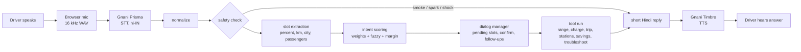

| Stage | Where | Notes |
|---|---|---|
| Speech to text | `gnani.py` → Prisma (`STT_URL`, `language_code=hi-IN`) | Called from `app.py` `/api/voice` |
| Normalization, numbers, slots | `nlu.py` | Token-based matching, Devanagari + romanized |
| Safety, scoring, dialog manager, logging | `agent.py` | `step(session, text)` is the entry point |
| Tools (calculators, lookups) | `tools.py` | Pure functions, unit-tested |
| Vehicle and NLU constants | `config.py` | Every value is labelled as an assumption |
| Demo data | `stations.py` | Synthetic stations and approximate route distances |
| Text to speech | `gnani.py` → Timbre (`TTS_MODEL`, `TTS_VOICE` as set in `gnani.py`) | Reply text is spoken back |
| Screen cards | `ui_view.py` | Turns each answer into card data (same rounding as the spoken reply) |
| Web server | `app.py` (Flask) | One `Session` per browser tab, in memory; returns reply, audio, `view` and `memory` |
| Driver web app | `templates/index.html` | Single page, no framework; see "The driver screen" below |

## Features

| Driver says | Agent does |
|---|---|
| "60% चार्ज है, कितना चलेगा और कितना खर्चा?" | Range plus charge time and cost in one answer |
| "कितना चलेगा?" → "साठ" → "हां" | Asks for the missing %, reads back the uncertain number, then answers |
| "और खर्चा?" / "और अगर 40% हो?" / "नहीं, सत्तर" | Follow-ups and corrections reuse the conversation state |
| "भोपाल से सीहोर जाना है, 30% है, पहुंच जाऊंगा?" | Trip check: yes / borderline / no, with a charge-before-leaving target and a demo charging point |
| "आज 80 km चलाया, कितना बचा?" | Electricity cost vs petrol and CNG autos, plus a monthly estimate |
| "पहले 90 चलती थी, अब 60" | Range-drop percentage with tiered advice, then an offer of step-by-step help |
| "चार्जर डिटेक्ट नहीं कर रहा" | One troubleshooting step at a time; "अगला" / "ठीक हो गया"; escalates to a mechanic at the end |
| "चार्जर से धुआं आ रहा है" | Safety reply first, overriding any open question |
| "जयपुर में चार्जिंग पॉइंट" | Number of demo points, the cheapest one, and the 24-hour one |
| Unclear input | Targeted question naming the top two guesses, and a simpler prompt after two failures |

## The driver screen

<table>
<tr><td align="center">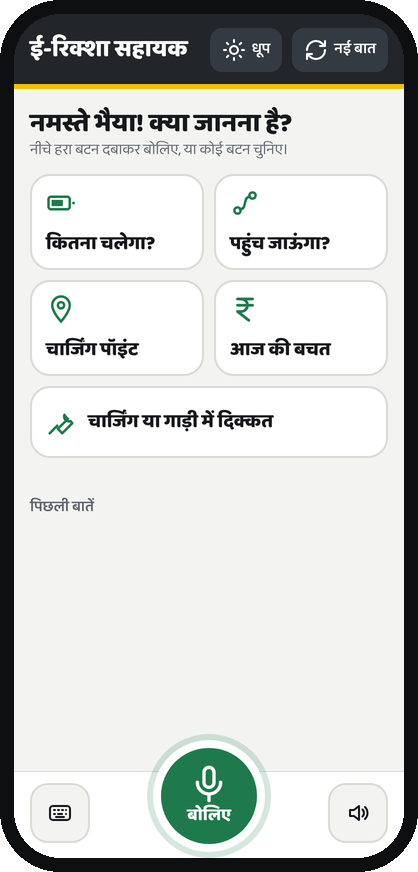<br><sub>Start screen</sub></td><td align="center">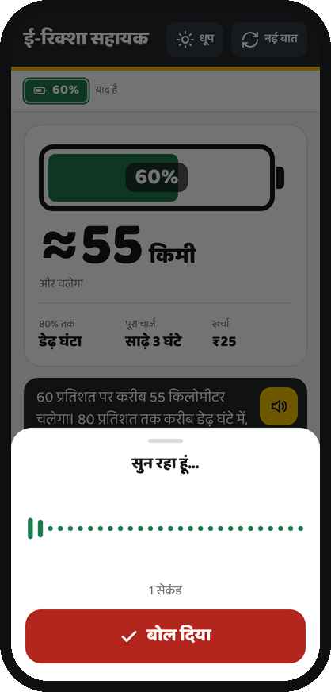<br><sub>Listening</sub></td><td align="center">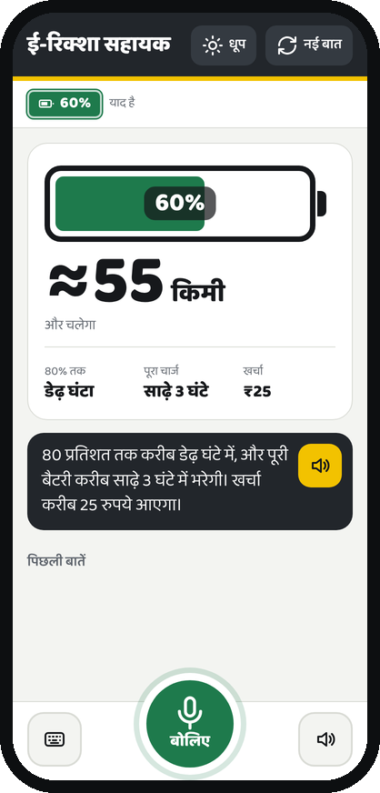<br><sub>Range, time, cost</sub></td><td align="center">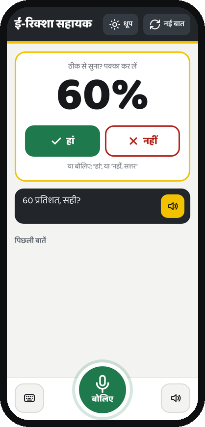<br><sub>Confirm a number</sub></td></tr>
<tr><td align="center">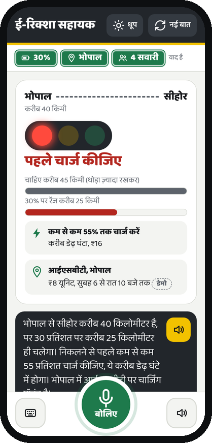<br><sub>Trip: charge first</sub></td><td align="center">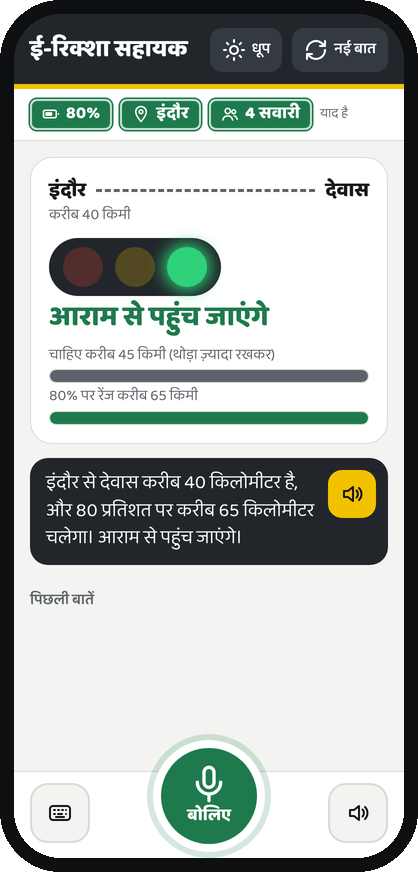<br><sub>Trip: OK</sub></td><td align="center">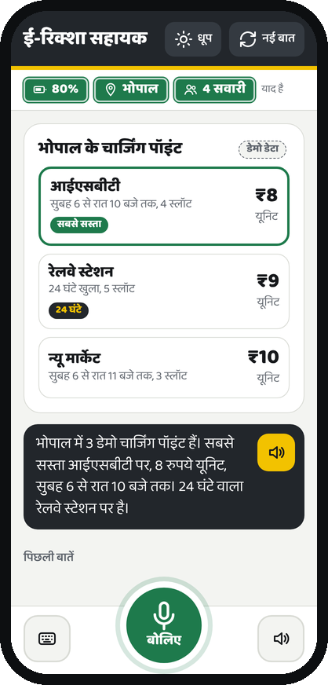<br><sub>Charging points</sub></td><td align="center">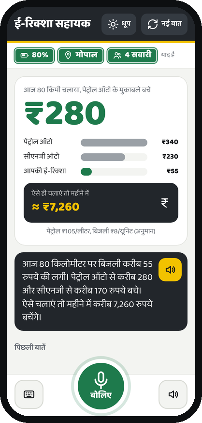<br><sub>Savings</sub></td></tr>
<tr><td align="center">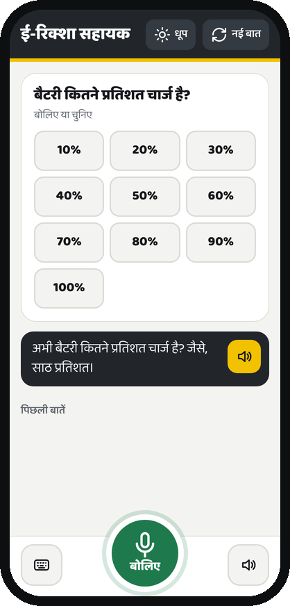<br><sub>Tap to answer</sub></td><td align="center">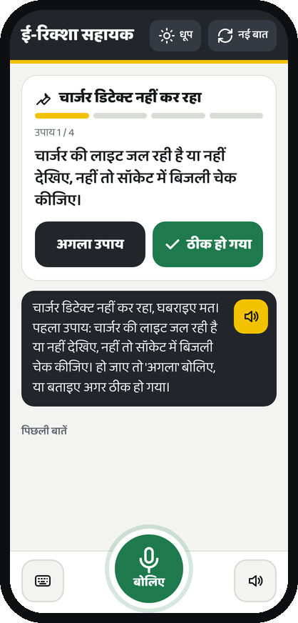<br><sub>Step-by-step fix</sub></td><td align="center">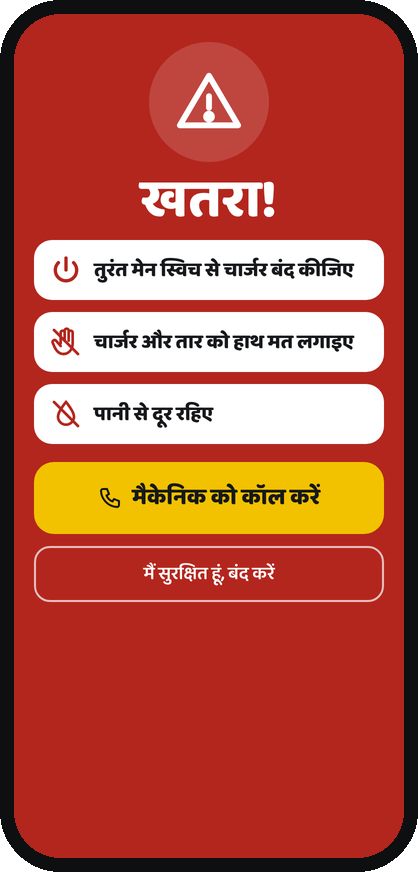<br><sub>Safety alert</sub></td><td align="center">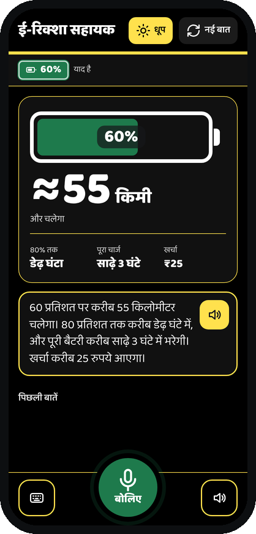<br><sub>Sun mode</sub></td></tr>
</table>

Screenshots of the running app (`templates/index.html` against the real agent). For the screenshots only, the
Gnani voice was replaced with silence because no API key was used. A short deck built from these screens is in
[`docs/EV-Agent-Driver-App.pptx`](docs/EV-Agent-Driver-App.pptx).

The page is built for a driver on a cheap Android phone, in sunlight, with one hand free:

- One big green mic button at the bottom; a sound-wave sheet while it listens (auto-stops after 15 s).
- Every answer is a card, not just text: battery gauge with km, a traffic light for "will I reach?",
  station cards with the cheapest highlighted, a savings card, and one-step-at-a-time troubleshooting.
- When the agent needs a number or city, the card shows big tap buttons (10%…100%, 10…100 km, city names),
  so the driver can tap instead of speaking in a noisy street.
- Uncertain numbers are confirmed with large हां / नहीं buttons.
- What the agent remembers (charge %, city, passengers) is shown as green EV-number-plate chips; tapping the
  battery plate changes the %.
- Safety answers take over the full screen in red, vibrate the phone, and offer a call button.
- धूप (sun) mode switches to black and yellow for direct sunlight; every reply has a replay button.
- Works down to 320 px wide, keyboard focus is visible, and reduced-motion settings are respected.
- No map is shown: there is no GPS or real map data, and a fake map would mislead a driver.

## Setup

```bash
python -m venv venv
source venv/bin/activate            # Windows: venv\Scripts\activate
pip install -r requirements.txt
cp .env.example .env                # put your Gnani API key in .env
```

## Run

```bash
python agent.py                     # text-only demo of the agent, no API key needed
python app.py                       # web app at http://localhost:5000
gunicorn -w 1 --threads 4 app:app   # deployment; ONE worker so conversation state stays in one process
```

For a public URL, the server has basic cost/abuse limits (set in `.env`): `MAX_UPLOAD_MB` (default 5),
`RATE_LIMIT_PER_MIN` per IP (default 30, `0` turns it off) and `MAX_SESSIONS` kept in memory (default 2000).
Behind a reverse proxy every request can share one IP; add Werkzeug's `ProxyFix` before relying on the rate limit.

Every turn is logged as one JSON line in `logs/turns.jsonl` (intent, score, slots, reply). Digit runs of 7+ digits
are masked before logging. Set `EV_AGENT_LOG_PATH=` (empty) to turn logging off.

## Tests and evaluation

```bash
pip install -r requirements-dev.txt
pytest -q                           # 154 tests: numbers, slots, intents, dialogs, safety, tools, screen cards, server limits
python eval_intents.py              # intent accuracy on clean + simulated-STT-error text -> eval_results.md
python noise_test.py                # real audio through Prisma: clean / traffic noise / 8 kHz phone line
python noise_test.py --rescore      # re-score saved transcripts with the current agent (no API key needed)
```

### Intent accuracy (from `eval_results.md`)

50 labelled synthetic utterances, 11 intents. Noisy rows corrupt each utterance 10 times with a documented
character/word-level STT-error simulator (drops, swaps, duplicates, script swaps, dropped words, merged words).

| condition | utterances | accuracy |
|---|---|---|
| clean | 50 | 100.0% |
| simulated STT errors, p=0.1 per word | 500 | 95.0% |
| simulated STT errors, p=0.2 per word | 500 | 90.4% |
| simulated STT errors, p=0.3 per word | 500 | 83.2% |

How to read these numbers:
- The eval set was written by the same author as the rules, before they were implemented. The first clean run
  scored 96%; two keyword gaps it exposed were then fixed. Safety matching was changed after the first noisy run.
  So these are optimistic estimates, not field results.
- The simulator is not a model of Prisma's real errors. Real-audio results come from `noise_test.py`, which needs
  your own synthetic or self-recorded clips and a Gnani key.
- Weakest under noise: `trouble_not_detecting` (68% at p=0.2) and `safety` (80% at p=0.2). Both depend on short
  phrases that break when a word is dropped.

## Limitations

- **Demo data.** Charging stations and prices in `stations.py` are invented. Route distances are approximate.
- **Assumed vehicle constants.** Battery size, range, charger power, the 80% charging taper, load derating and fuel
  prices in `config.py` are assumptions, not measurements. Set them for your vehicle.
- **Simple models.** Range is linear in charge %, load derating is linear per passenger, and charging is a two-stage
  approximation. Terrain, temperature and battery chemistry are not modelled.
- **Rule-based NLU.** Phrasing outside the keyword lists is not understood. The agent asks a clarifying question
  instead of guessing, but coverage is limited to the domains above.
- **Similar-sounding numbers.** If STT turns "साठ" (60) into "सात" (7) and the driver also said "प्रतिशत", the
  agent treats 7% as certain and answers for 7%. Read-back only happens for numbers without a unit or cue.
- **In-memory sessions.** Conversation state lives in the Flask process and is lost on restart.
- **No embedding classifier.** An optional fallback hook exists (`agent.register_fallback_classifier`,
  `config.USE_EMBEDDINGS`), but no model ships with this build, so nothing is claimed for it.

## Project layout

```
agent.py          Session, safety check, intent scoring, dialog manager, logging, step()/respond()
nlu.py            normalize(), Hindi numbers 0-100, slot extraction, token/fuzzy matching
tools.py          range, charging time/cost, trip, stations, savings, range-drop diagnosis, troubleshooting text
config.py         VehicleConfig (all assumptions) and NLU thresholds
stations.py       synthetic stations, demo routes, place names
app.py            Flask server: /api/voice, /api/text, /api/reset
gnani.py          Gnani Prisma (STT) and Timbre (TTS) HTTP calls
noise_test.py     audio robustness test through Prisma (noise + 8 kHz phone line)
eval_intents.py   text-level intent evaluation with an STT-error simulator
eval_set.py       labelled evaluation utterances
tests/            pytest suite
templates/        single-page driver web app
ui_view.py        card data for the web app
docs/             screenshots of the app and a short deck
```

All recordings, phone numbers and test utterances used with this project must be synthetic, as the contest
rules require.
