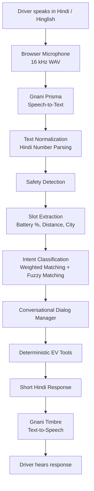

# ⚡ Intelligent EV Ownership Agent
### A Hindi Voice-First AI Assistant for India's E-Rickshaw Drivers

<p align="center">
  <strong>Making EV ownership assistance accessible through conversational Hindi and voice AI.</strong>
</p>

<p align="center">
  <a href="https://intelligent-ev-ownership-agent.onrender.com/"><strong>🚀 Live Demo</strong></a>
  &nbsp; • &nbsp;
  <a href="https://github.com/regardsvaibhav/Intelligent-EV-Ownership-Agent"><strong>💻 GitHub Repository</strong></a>
</p>

<p align="center">
  Built for the <strong>Great Indian AI Internship Challenge by Gnani AI</strong>
</p>

---

## 🚀 Overview

Owning and operating an electric rickshaw comes with everyday questions:

- How far can I travel with my current battery charge?
- How long will charging take, and how much will it cost?
- Can I complete a particular journey with the remaining battery?
- Where can I find a charging point?
- How much am I saving compared to petrol or CNG?
- What should I do if my charger stops working?

**Intelligent EV Ownership Agent** is a voice-first conversational assistant designed to answer these questions in Hindi and Hinglish.

Drivers can simply speak naturally instead of navigating complicated interfaces or typing technical queries. The agent understands their questions, remembers relevant conversation context, asks follow-up questions when necessary, and provides short, actionable spoken responses.

The application combines Gnani AI's speech technologies with a custom conversational agent, deterministic calculation tools, and an interface designed for practical mobile use.

## 🎯 Key Features

| Feature | What it does |
|---|---|
| 🔋 Battery Range Estimation | Estimates remaining driving range using battery charge and vehicle assumptions. |
| ⚡ Charging Calculator | Calculates approximate charging time and electricity cost. |
| 🛺 Trip Feasibility | Evaluates whether a journey is possible with the available battery charge. |
| 📍 Charging Point Discovery | Provides demo charging-point information, including approximate distances and costs. |
| 💰 Savings Calculator | Compares electricity expenditure against petrol and CNG alternatives. |
| 🔧 Troubleshooting Assistant | Guides drivers through charging-related problems one step at a time. |
| 🛡️ Safety Detection | Prioritises safety responses for situations involving smoke, sparks or electric shocks. |
| 🗣️ Hindi Voice Interaction | Supports Hindi and Hinglish speech input and spoken responses. |
| 🧠 Conversational Memory | Retains relevant information across turns and handles corrections and follow-up questions. |

## 💬 What Can You Ask?

The assistant supports practical, everyday conversations rather than requiring rigid commands.

| Driver's query | Agent's response |
|---|---|
| "60% चार्ज है, कितना चलेगा?" | Estimated remaining range. |
| "चार्ज होने में कितना टाइम लगेगा?" | Approximate charging duration and cost. |
| "भोपाल से सीहोर जाना है, 30% है, पहुंच जाऊंगा?" | Trip feasibility and charging recommendation. |
| "आज 80 km चलाया, कितना बचा?" | Estimated savings against petrol and CNG. |
| "पहले 90 चलती थी, अब 60" | Range degradation estimation and advice. |
| "चार्जर डिटेक्ट नहीं कर रहा" | Step-by-step troubleshooting. |
| "चार्जर से धुआं आ रहा है" | Immediate safety-prioritised response. |
| "जयपुर में चार्जिंग पॉइंट बताओ" | Available demo charging-point information. |

**Context-aware conversations:**

The agent can also handle incomplete queries and follow-ups.

For example:

1. Driver: "कितना चलेगा?"
2. Agent: Asks for the current battery percentage.
3. Driver: "साठ।"
4. Agent: Confirms an uncertain number when necessary.
5. Driver: "हां।"
6. Agent: Calculates the estimated driving range.

It also understands corrections such as "नहीं, सत्तर" and follow-ups such as "और खर्चा?"

## 🖥️ Application Preview

The interface is designed around the practical constraints of an e-rickshaw driver: a mobile-first layout, large touch targets, minimal interaction and readable information.

| | | |
|:---:|:---:|:---:|
| **Home Screen** | **Voice Listening** | **Battery Range** |
|  |  |  |
| **Trip Assessment** | **Charging Points** | **Savings** |
|  |  |  |
| **Troubleshooting** | **Safety Alert** | **Sunlight Mode** |
|  |  |  |

*Screenshots show the application's interface. For these screenshots, voice output was replaced with silence because no Gnani API key was used.*

## 🏗️ System Architecture

The application follows a modular architecture combining speech processing, rule-based natural language understanding, conversational state management and deterministic tools.



### Core Processing Pipeline

**1. Speech Recognition — Gnani Prisma**

Converts the driver's spoken Hindi input into text using Gnani AI's speech-to-text service, configured for `hi-IN`.

**2. Natural Language Understanding**

A custom rule-based NLU pipeline performs:

- Hindi and Hinglish text normalization.
- Devanagari and romanized Hindi number parsing (0–100).
- Slot extraction for battery percentage, distance, city and passenger count.
- Weighted keyword and phrase matching.
- Fuzzy matching using RapidFuzz to handle common speech-to-text spelling errors.

**3. Conversational Dialog Management**

The agent maintains per-session conversation state and supports:

- Missing-information detection.
- Follow-up questions.
- Number confirmation.
- User corrections.
- Resuming previously incomplete queries.
- Safety-prioritised responses.

**4. Deterministic EV Tools**

The agent invokes specialised calculation and lookup functions for range estimation, charging, trip feasibility, savings and troubleshooting.

**5. Voice Generation — Gnani Timbre**

Converts the generated Hindi response into speech, completing the voice interaction loop.

## 🧠 Engineering Approach: Rule-Based Agent + Optional LLM

An important design decision was to avoid making the entire application dependent on an LLM.

The primary conversational system uses deterministic NLU, a dialog manager and specialised tools. This allows calculations to remain predictable and transparent.

An optional LLM fallback is available for queries that the rule-based system cannot understand.

### How the fallback works

When the rules cannot identify an intent:

1. The optional LLM classifies the query and extracts relevant information.
2. If it identifies a supported intent, the request is passed to the existing agent tools.
3. If it identifies a general EV question, it can generate a short Hindi response.
4. Unsupported queries, invalid responses and timeouts fall back to the normal clarification response.

**An important distinction:** The LLM does not calculate battery range, charging costs or trip feasibility. These numerical outputs continue to come from the deterministic tools.

The default fallback provider is Google Gemini through an OpenAI-compatible API interface. It can also be configured with compatible providers such as Groq or OpenRouter.

The LLM fallback is optional; the core agent works without an LLM API key.

## 🛠️ Technology Stack

| Component | Technology |
|---|---|
| Speech-to-Text | Gnani AI Prisma |
| Text-to-Speech | Gnani AI Timbre |
| Backend | Python, Flask |
| Natural Language Understanding | Custom rule-based NLU |
| Fuzzy Matching | RapidFuzz |
| Optional LLM | Google Gemini / OpenAI-compatible APIs |
| Frontend | HTML, CSS, JavaScript |
| Audio Processing | WAV, 16 kHz |
| Testing | Pytest |
| Deployment | Gunicorn, Render |

## 📁 Project Structure

```text
Intelligent-EV-Ownership-Agent/
│
├── agent.py              # Agent orchestration and dialog management
├── nlu.py                # Hindi number parsing and intent recognition
├── tools.py              # EV calculations and troubleshooting tools
├── config.py             # Vehicle assumptions and NLU configuration
├── stations.py           # Demo charging stations and routes
├── gnani.py              # Gnani Prisma and Timbre integrations
├── llm_fallback.py       # Optional LLM fallback
├── app.py                # Flask application and API endpoints
├── ui_view.py            # Response-to-UI card generation
│
├── templates/
│   └── index.html        # Driver-facing web interface
│
├── docs/
│   ├── screens/          # Application screenshots
│   └── EV-Agent-Driver-App.pptx
│
├── tests/                # Automated test suite
│
├── eval_set.py           # Labelled evaluation utterances
├── eval_intents.py       # Intent recognition evaluation
├── noise_test.py         # Speech recognition robustness tests
│
├── requirements.txt
├── requirements-dev.txt
├── .env.example
└── README.md
```

## ⚙️ Getting Started

### Prerequisites

- Python 3.10+
- Gnani AI API credentials for voice interaction.
- Optional: Google Gemini or another compatible API key for LLM fallback.

### 1. Clone the repository

```bash
git clone https://github.com/regardsvaibhav/Intelligent-EV-Ownership-Agent.git

cd Intelligent-EV-Ownership-Agent
```

### 2. Create a virtual environment

**Windows:**

```bash
python -m venv venv
venv\Scripts\activate
```

**Linux / macOS:**

```bash
python -m venv venv
source venv/bin/activate
```

### 3. Install dependencies

```bash
pip install -r requirements.txt
```

For development and testing:

```bash
pip install -r requirements-dev.txt
```

### 4. Configure environment variables

Create your local environment file:

```bash
cp .env.example .env
```

Add your Gnani AI credentials and configure the relevant speech-to-text settings as documented in `.env.example`.

For the optional LLM fallback, configure:

```env
LLM_API_KEY=your_api_key
```

Additional optional settings:

```env
LLM_MODEL=gemini-3.8-flash
LLM_TIMEOUT_SEC=8
LLM_FALLBACK=1
```

Set `LLM_FALLBACK=0` to disable the LLM fallback entirely.

**Never commit your `.env` file or API credentials to GitHub.**

### 5. Run the application

For a text-only demonstration without API credentials:

```bash
python agent.py
```

To launch the web application:

```bash
python app.py
```

Open:

```text
http://localhost:5000
```

For deployment:

```bash
gunicorn -w 1 --threads 4 app:app
```

The application uses in-memory conversation sessions, so a single worker is recommended to keep session state within one process.

## 📊 Testing & Evaluation

The project includes automated tests and an intent-recognition evaluation pipeline.

### Automated Testing

```bash
pytest -q
```

The test suite contains **181 tests** covering:

- Hindi number parsing.
- Slot extraction and intent recognition.
- Dialog management and follow-up handling.
- Safety detection.
- EV calculation tools.
- UI response cards.
- Server-side limits.

### Intent Recognition Evaluation

The evaluation uses 50 labelled synthetic utterances across 11 intents, with simulated speech-to-text errors at different corruption probabilities.

| Evaluation condition | Test utterances | Accuracy |
|---|---:|---:|
| Clean text | 50 | 100.0% |
| Simulated STT errors (p = 0.1) | 500 | 95.0% |
| Simulated STT errors (p = 0.2) | 500 | 90.4% |
| Simulated STT errors (p = 0.3) | 500 | 83.2% |

Run the evaluation:

```bash
python eval_intents.py
```

### Audio Robustness Testing

The project also includes a test pipeline for evaluating speech recognition under different audio conditions.

```bash
python noise_test.py
```

It supports testing:

- Clean audio.
- Simulated traffic noise.
- 8 kHz telephone-line audio.

This requires Gnani API credentials and suitable synthetic or self-recorded audio clips.

**Evaluation caveat:** The intent evaluation set was authored by the same developer who implemented the rules. The results are therefore preliminary and optimistic, not independent benchmarks or real-world field accuracy. Simulated errors are also not a substitute for actual Prisma recognition errors.

## ⚠️ Assumptions & Limitations

The project is a functional prototype, not a production-grade vehicle diagnostic or charging infrastructure platform.

- **Synthetic charging data:** Charging stations, prices and route distances are demonstration data, not verified live listings.
- **Vehicle assumptions:** Battery capacity, range, charger power, electricity prices and fuel prices are configurable assumptions.
- **Simplified calculations:** Range estimation uses linear models. Charging is approximated using a two-stage charging model.
- **Limited environmental modelling:** Terrain, temperature and battery chemistry are not fully modelled.
- **Rule-based understanding:** Queries outside supported patterns may require clarification.
- **In-memory sessions:** Conversation history is lost when the Flask process restarts.
- **LLM fallback:** General EV responses are not independently verified against a knowledge base.
- **No live navigation:** The application does not use GPS or live map data.

The application should not be treated as a substitute for professional vehicle inspection or electrical safety procedures.

## 🔒 Privacy & Safety

- Digit sequences containing seven or more digits are masked before conversation logs are written.
- Logging can be disabled using `EV_AGENT_LOG_PATH=`.
- Safety-related keywords are checked before optional LLM processing.
- The system prioritises safety responses when detecting situations such as smoke, sparks or electric shocks.
- Only synthetic recordings, phone numbers and test utterances should be used in accordance with the challenge requirements.

## 🔮 Future Scope

Potential improvements include:

- Integration with verified, real-time EV charging station databases.
- Personalised battery estimation using actual vehicle telemetry.
- Regional language support beyond Hindi and Hinglish.
- Retrieval-augmented generation for verified EV ownership guidance.
- Persistent user profiles and conversation history.
- Integration with vehicle diagnostics and battery management systems.
- Real-world testing with e-rickshaw drivers.

## 🏁 Acknowledgements

Developed as a submission for the **Great Indian AI Internship Challenge by Gnani AI**, exploring the practical application of Indian speech AI technologies in the electric mobility ecosystem.

Special thanks to Gnani AI for providing the opportunity to build with its speech technologies.

---

<p align="center">
  <strong>Built with ⚡ for India's electric mobility ecosystem.</strong>
  <br/>
  <sub>Vaibhav | <a href="https://github.com/regardsvaibhav">GitHub</a> | <a href="https://www.linkedin.com/in/vaibhavrgipt/">LinkedIn</a></sub>
  <sub>Kanak Sharma | <a href="https://github.com/KanakSharma0308">GitHub</a> | <a href="https://www.linkedin.com/in/kanak-sharma-101023392?originalSubdomain=in">LinkedIn</a></sub>
  
</p>
